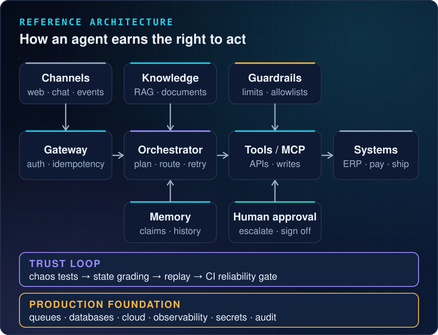
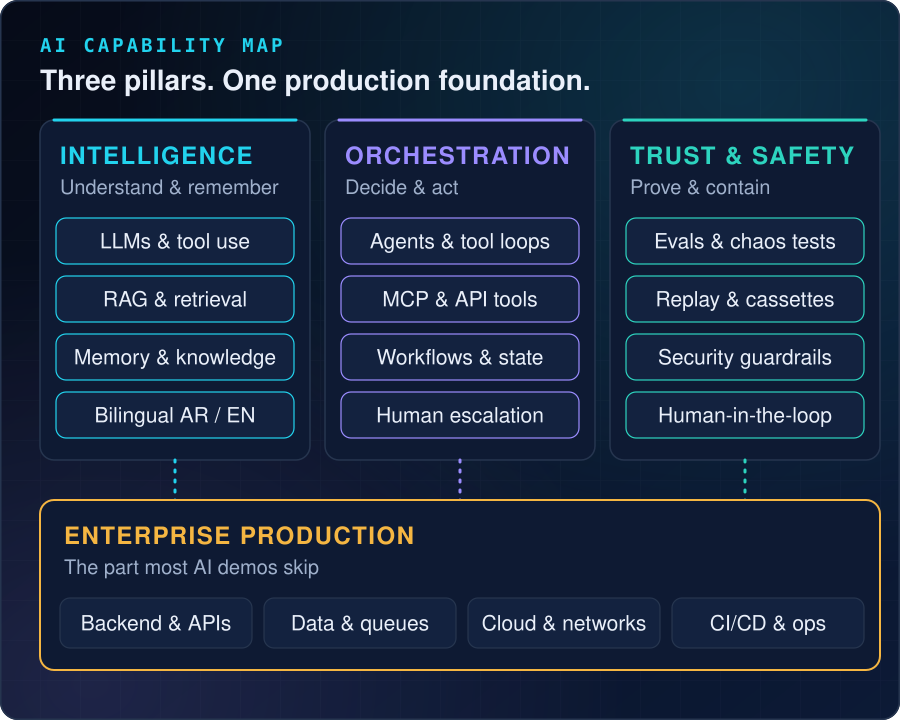
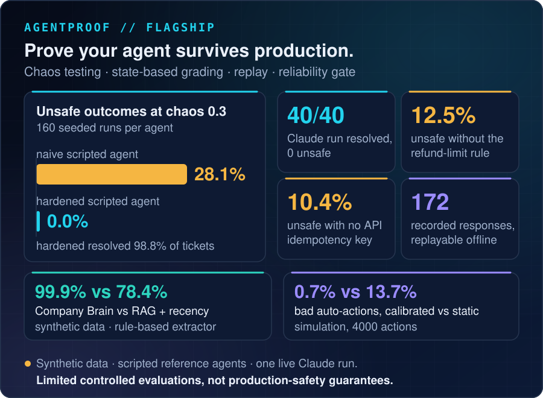
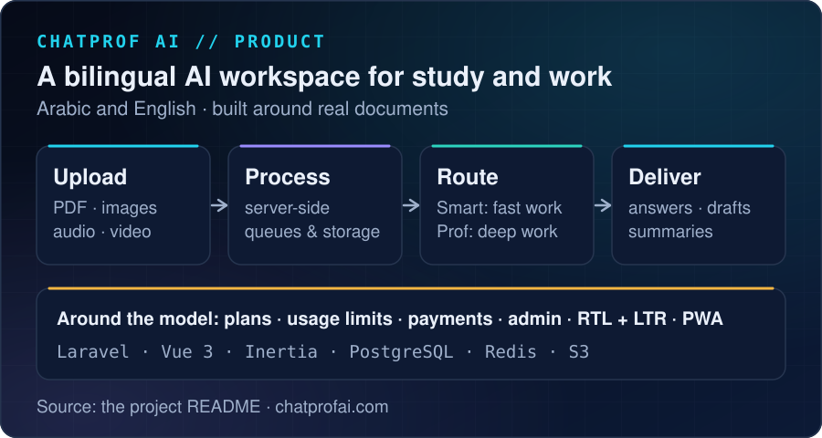
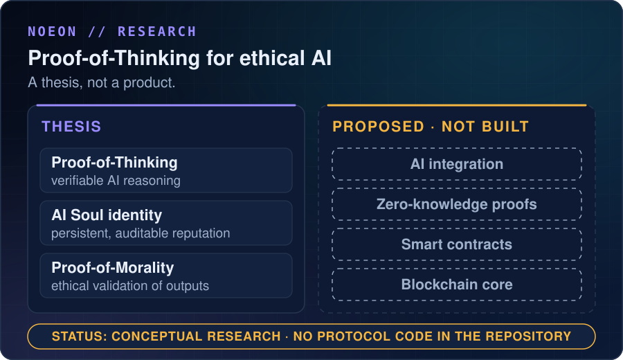
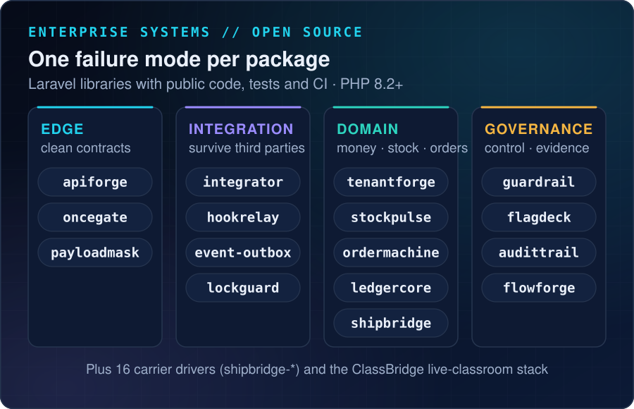
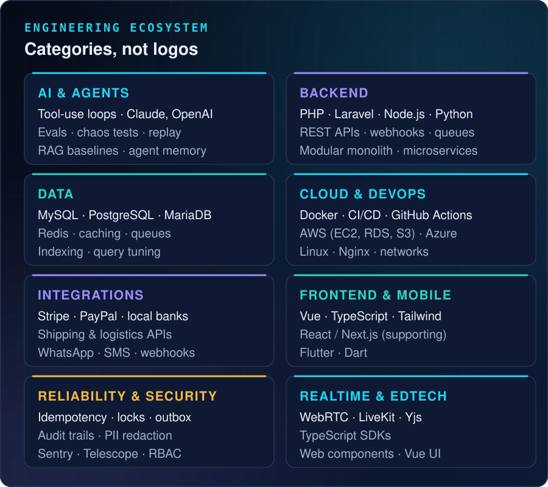
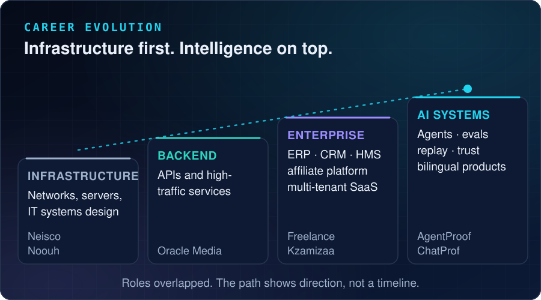

<!--
  Mohamed Hekal · GitHub profile · HEKAL // INTELLIGENT SYSTEMS LAB
  Only Markdown, GitHub-safe HTML and hand-authored SVG. Assets live in ./assets (dark + "-light" variants).
  Every project carries an evidence label: Implemented · Professional experience · Research · Experimental · Planned.
-->

<!-- ============ 01 · HERO ============ -->
<p align="center">
  <picture>
    <source media="(prefers-color-scheme: dark)" srcset="assets/ai-hero.svg">
    <source media="(prefers-color-scheme: light)" srcset="assets/ai-hero-light.svg">
    
  </picture>
</p>

<h3 align="center"><i>I engineer intelligent systems that don't just think — they act, integrate, scale, and survive production.</i></h3>

<p align="center">
  <a href="https://github.com/mohamedhekal"><b>GitHub</b></a> &nbsp;·&nbsp;
  <a href="https://www.linkedin.com/in/mohekal/"><b>LinkedIn</b></a> &nbsp;·&nbsp;
  <a href="mailto:mohamed.k.hekal@gmail.com"><b>Email</b></a> &nbsp;·&nbsp;
  <a href="https://codemista.com"><b>codemista.com</b></a>
</p>

<p align="center">
  <sub>Mohamed Khaled Ahmed Hamad · Egypt · Arabic / English</sub>
</p>

<p align="center">
  <sub>
    <a href="#02--philosophy">Philosophy</a> ·
    <a href="#03--ai-systems">AI systems</a> ·
    <a href="#05--flagship-ai-projects">Flagship projects</a> ·
    <a href="#07--reliability-evaluation-security">Reliability</a> ·
    <a href="#08--enterprise-architecture">Enterprise</a> ·
    <a href="#10--open-source">Open source</a> ·
    <a href="#14--contact">Contact</a>
  </sub>
</p>

> **How to read this profile.** Numbers come from public repositories and are shown next to their limits. Each project is labelled
> **Implemented** (public code), **Professional experience** (private work, described in general terms only), **Research**, **Experimental** or **Planned**.

---

## 02 · Philosophy

An agent that works in a demo has proven almost nothing. Production adds retries, duplicate deliveries, half-applied writes, hostile input and tired humans. My work sits in the gap between *"it answered correctly"* and *"it can be trusted with the keys"*.

| Principle | What it means in practice |
|:--|:--|
| **Autonomy is earned** | An agent gets authority in proportion to the evidence it has survived, and loses it when the evidence drifts. |
| **Grade the world, not the transcript** | Check the final state (money, shipments, messages), never what the agent says it did. |
| **Put guards in code, not only in prompts** | Business policy such as a refund limit belongs in the tool, not just in the system prompt. |
| **Design for the retry** | Idempotency keys, locks and outboxes first. Failure is the normal case. |
| **Keep humans where judgment lives** | Escalation is a designed path, with a measured cost. |

<sub>Each principle maps to a measurement in [AgentProof](https://github.com/mohamedhekal/agentproof) (see section 07).</sub>

---

## 03 · AI systems

The lifecycle I work across: **Architect → Build → Integrate → Orchestrate → Evaluate → Secure → Deploy → Operate → Improve.**
Most AI projects stop after *Build*. I care about everything after it.

<p align="center">
  <picture>
    <source media="(prefers-color-scheme: dark)" srcset="assets/agent-architecture.svg">
    <source media="(prefers-color-scheme: light)" srcset="assets/agent-architecture-light.svg">
    
  </picture>
</p>

<sub>A reference pattern, not a product. The *trust loop* is what [AgentProof](https://github.com/mohamedhekal/agentproof) implements; the foundation is where my backend and infrastructure background applies.</sub>

<details>
<summary><b>Text version of the diagram</b></summary>

- **Flow:** channels → gateway (auth, idempotency) → orchestrator (plan, route, retry) → tools / MCP (APIs, writes) → systems of record (ERP, payments, shipping).
- **Attached to the orchestrator:** knowledge (documents, RAG), memory (claims, history), guardrails (limits, allowlists in code), human approval (escalate, sign off).
- **Over everything:** a trust loop (chaos tests → state grading → replay → CI reliability gate) on a production foundation (queues, databases, cloud, observability, secrets, audit).

</details>

---

## 04 · AI capability map

<p align="center">
  <picture>
    <source media="(prefers-color-scheme: dark)" srcset="assets/ai-capability-map.svg">
    <source media="(prefers-color-scheme: light)" srcset="assets/ai-capability-map-light.svg">
    
  </picture>
</p>

---

## 05 · Flagship AI projects

### AgentProof &nbsp;`Implemented` · open source · MIT

*Prove your agent survives production, not just the demo.* A zero-dependency Python harness that sabotages tool calls the way production does, grades the final state of a simulated world, records every run as a replayable cassette, and blocks a pull request when reliability regresses.

<p align="center">
  <picture>
    <source media="(prefers-color-scheme: dark)" srcset="assets/agentproof-showcase.svg">
    <source media="(prefers-color-scheme: light)" srcset="assets/agentproof-showcase-light.svg">
    
  </picture>
</p>

> **Read these numbers with their limits.** They are limited, controlled evaluations on **synthetic data**. The two reference agents are *scripted policies*, not LLMs. The Claude result is **one recorded run of 40 simulations** with a prompt that states the rules. The Company Brain extractor is **rule-based** and the autonomy result is a **simulation**. None of this is a production-safety guarantee.

- **Chaos:** timeouts that *did* apply the write, duplicated deliveries, lost acknowledgements, malformed payloads.
- **State-based grading:** two axes, *did it resolve the ticket* and *did it do something that must never happen*.
- **Replay:** every run is a cassette; re-run an agent against a recorded failure with no network and no randomness.
- **LLM adapters:** Anthropic and OpenAI tool-use loops. Measured on Claude only; the OpenAI path is tested against a local protocol server and has not been run against a live OpenAI model.
- **Calibrated autonomy** (simulation) and a **bitemporal Company Brain** (rule-based, synthetic data).

<p>
  <a href="https://github.com/mohamedhekal/agentproof"><b>Repository</b></a> &nbsp;·&nbsp;
  <a href="https://mohamedhekal.github.io/agentproof/"><b>Live browser demo</b></a> &nbsp;·&nbsp;
  <a href="https://github.com/mohamedhekal/agentproof/wiki">Wiki</a> &nbsp;·&nbsp;
  <a href="https://github.com/mohamedhekal/agentproof/releases/tag/v0.1.0">Release v0.1.0 (explainer videos, EN / AR)</a>
</p>

<details>
<summary><b>The numbers, in full, and how to reproduce them</b></summary>

<br>

**Scripted reference agents** · chaos 0.3 · 8 scenarios × 20 seeded runs = 160 runs per agent

| Agent | Resolved | Handed to a human | Unsafe | Reliability (pass^k) |
|:--|--:|--:|--:|--:|
| naive | 56.2% | 15.6% | **28.1%** | 0.0% |
| hardened | 98.8% | 1.2% | **0.0%** | 87.5% |
| hardened, retries off | 33.1% | 66.9% | **0.0%** | 0.0% |

**Recorded Claude run** (`claude-sonnet-5-5`, chaos 0.3, 5 seeds × 8 scenarios): 40/40 resolved, 0 unsafe, 172 recorded responses, replayable offline. Zero failures in 40 runs only supports a true pass rate above roughly 92%.

**Prompt ablation** (48 runs per variant): removing the refund-limit rule → **12.5% unsafe**; removing the API's idempotency-key parameter → **10.4% unsafe**. Generic engineering hygiene was already in the model; business policy was not. Put the guard in the tool.

**Company Brain** (rule-based extractor, ~540 invented messages per seed, 10 seeds): 99.9% vs 78.4% for RAG with recency, which the repository itself calls a ceiling, not a forecast. With 30% unseen phrasing: 76.3% vs 59.7%.

**Calibrated autonomy** (simulation, 4000 actions): 0.7% bad actions sent without a human, vs 13.7% for a static threshold.

```bash
git clone https://github.com/mohamedhekal/agentproof && cd agentproof
pip install -e .                  # no runtime dependencies
agentproof compare                # naive vs hardened under chaos
agentproof compare --agents replay:cassettes/claude.jsonl --runs 5 --chaos 0.3   # the Claude run, offline
```

</details>

### ChatProf AI &nbsp;`Implemented` · product

A **bilingual (Arabic / English) AI workspace** for study and work: users bring their own documents and get explanations they can use. According to the project README it covers file pipelines, plans and usage limits, payments, an admin dashboard and a PWA, built on Laravel, Vue 3 and Inertia with PostgreSQL, Redis and S3.

<p align="center">
  <picture>
    <source media="(prefers-color-scheme: dark)" srcset="assets/chatprof-showcase.svg">
    <source media="(prefers-color-scheme: light)" srcset="assets/chatprof-showcase-light.svg">
    
  </picture>
</p>

<a href="https://chatprofai.com"><b>chatprofai.com</b></a> &nbsp;·&nbsp; <a href="https://github.com/mohamedhekal/Chatprof-AI">Project page on GitHub</a>

### Noeon &nbsp;`Research` · conceptual

A **thesis, not a product**: a proposal for verifiable AI reasoning (*Proof-of-Thinking*), persistent AI identity and reputation, and ethical validation. The repository holds a whitepaper and roadmap. **No protocol code has been written**, and the architecture below is drawn dashed for that reason.

<p align="center">
  <picture>
    <source media="(prefers-color-scheme: dark)" srcset="assets/noeon-research.svg">
    <source media="(prefers-color-scheme: light)" srcset="assets/noeon-research-light.svg">
    
  </picture>
</p>

<a href="https://github.com/mohamedhekal/Noeon-The-Proof-of-Thinking-Network-for-Ethical-AI-Souls"><b>Whitepaper and roadmap</b></a>

### AI in customer operations &nbsp;`Professional experience`

I run **AI customer-service and order-confirmation agents on a production e-commerce platform in Egypt**: WhatsApp automation, order workflows, tool and MCP-based integration, and human escalation when the agent should not decide alone. This is private work, so it is described only in general terms. It is also the reason AgentProof exists.

---

## 06 · Agentic AI, LLM, MCP and RAG

| Area | What I do | Evidence |
|:--|:--|:--|
| **Agents and tool use** | Tool-use loops over Anthropic and OpenAI APIs, parallel tool calls, fault-tolerant retries | `Implemented` ([AgentProof](https://github.com/mohamedhekal/agentproof)) |
| **MCP and API tools** | Designing the tool surface an agent acts through, so every write is safe to retry | `Professional experience` (private). An MCP server for the chaos proxy is on the AgentProof roadmap: `Planned` |
| **RAG and retrieval** | Compared retrieval strategies (top-1, recency-aware) against a bitemporal claim log on synthetic data | `Experimental`. I do not claim a production vector-search system here |
| **Memory and knowledge** | Bitemporal claim log with provenance and conflict flags; the extractor is a pluggable function and an LLM extractor is the next step | `Experimental` (rule-based) · LLM extractor `Planned` |
| **Evaluation** | Chaos testing, state-based grading, pass^k reliability, prompt ablations, record / replay cassettes | `Implemented` |
| **Human-in-the-loop** | A router that learns *when* to ask a human and falls back to asking when it detects drift | `Experimental` (simulation) |
| **Bilingual products** | Arabic RTL and English LTR as first-class requirements, including [Arabic address parsing](https://github.com/mohamedhekal/arabic-address-parser) | `Implemented` |

---

## 07 · Reliability, evaluation, security

What the AgentProof experiments say, in one line each (all on synthetic data):

- **Safety and liveness are different properties.** With retries off, the hardened agent stayed perfectly safe but handed two thirds of tickets to humans. Measure both.
- **Policy belongs in code.** Removing the refund-limit rule from the prompt let a model issue high-value refunds with no approval (12.5% unsafe).
- **Make writes retry-safe at the API.** When the API had no idempotency-key parameter, the model retried a timed-out write and applied it twice (10.4% unsafe), and some failures were the platform delivering a write twice, which no prompt can prevent.
- **Untrusted text is data.** Order notes can carry injected instructions; the naive agent obeyed them, the hardened agent did not.
- **A failure you cannot reproduce is a test you cannot write.** Cassettes turn it into one that runs offline in CI.

<details>
<summary><b>Engineering practices behind it</b></summary>

- **Fault model:** read faults and write faults, including *timeout-but-applied* and *duplicate delivery*.
- **Security hygiene in CI:** the AgentProof workflow uses `contents: read` only, pins actions to commit SHAs and checks the tree for secrets and private files.
- **Reproducibility:** everything is seeded and deterministic; recorded model responses are keyed by a hash of system prompt, conversation and tool schemas, and a cache miss fails loudly.
- **Honest limits:** each result in the repository is published with its caveats, and the commercial slides are labelled a proposal rather than traction.

</details>

---

## 08 · Enterprise architecture

AI that touches money, stock and customers has to sit on a backend that already handles retries, concurrency and audit. That is the other half of my work: ERP, CRM and hospital-management systems, a multi-channel affiliate platform, multi-tenant SaaS, deployed on AWS and Azure `Professional experience`.

I turned the recurring failure modes into small open-source Laravel packages `Implemented`:

<p align="center">
  <picture>
    <source media="(prefers-color-scheme: dark)" srcset="assets/enterprise-systems.svg">
    <source media="(prefers-color-scheme: light)" srcset="assets/enterprise-systems-light.svg">
    
  </picture>
</p>

<details>
<summary><b>What each package solves</b></summary>

<br>

| Package | Solves |
|:--|:--|
| [`oncegate`](https://github.com/mohamedhekal/oncegate) | Idempotency-Key middleware: replay, mismatch and in-flight handling |
| [`hookrelay`](https://github.com/mohamedhekal/hookrelay) | Signed webhooks with retries, dead-letter queue and inbound ingest |
| [`integrator`](https://github.com/mohamedhekal/integrator) | Retries, rate limits and circuit breakers for third-party HTTP |
| [`event-outbox`](https://github.com/mohamedhekal/event-outbox) | Transactional outbox and idempotent consumers |
| [`lockguard`](https://github.com/mohamedhekal/lockguard) | Safe distributed locks with owner tokens |
| [`tenantforge`](https://github.com/mohamedhekal/tenantforge) | Shared-database multi-tenancy: domains, memberships, API keys |
| [`stockpulse`](https://github.com/mohamedhekal/stockpulse) | Inventory reserve, commit, release and transfer with locked balances |
| [`ordermachine`](https://github.com/mohamedhekal/ordermachine) | Configurable order lifecycle state machine |
| [`ledgercore`](https://github.com/mohamedhekal/ledgercore) | Double-entry ledger with period locks and trial balance |
| [`shipbridge`](https://github.com/mohamedhekal/shipbridge) | One shipping API across 16 carrier drivers |
| [`guardrail`](https://github.com/mohamedhekal/guardrail) | Team roles, abilities and audited impersonation |
| [`flagdeck`](https://github.com/mohamedhekal/flagdeck) | Feature flags with percentage rollouts and tenant targeting |
| [`audittrail`](https://github.com/mohamedhekal/audittrail) · [`payloadmask`](https://github.com/mohamedhekal/payloadmask) | Compliance audit history · PII and secret redaction |
| [`flowforge`](https://github.com/mohamedhekal/flowforge) · [`apiforge`](https://github.com/mohamedhekal/apiforge) | Embeddable workflows · API versioning and error envelopes |
| [ClassBridge stack](https://github.com/mohamedhekal/classbridge) | Live classrooms: Laravel core, LiveKit driver, TypeScript SDK, Yjs whiteboard, Vue UI |

</details>

---

## 09 · Technology ecosystem

<p align="center">
  <picture>
    <source media="(prefers-color-scheme: dark)" srcset="assets/engineering-ecosystem.svg">
    <source media="(prefers-color-scheme: light)" srcset="assets/engineering-ecosystem-light.svg">
    
  </picture>
</p>

<details>
<summary><b>Text version</b></summary>

- **AI and agents:** tool-use loops (Claude, OpenAI) · evals, chaos tests, replay · RAG baselines, agent memory
- **Backend:** PHP, Laravel, Node.js, Python · REST APIs, webhooks, queues · modular monolith, microservices
- **Data:** MySQL, PostgreSQL, MariaDB · Redis · indexing and query tuning
- **Cloud and DevOps:** Docker, CI/CD, GitHub Actions, GitLab CI · AWS (EC2, RDS, S3), Azure · Linux, Nginx, networks
- **Integrations:** Stripe, PayPal, local banks · shipping and logistics APIs · WhatsApp, SMS
- **Frontend and mobile:** Vue, TypeScript, Tailwind · React / Next.js (supporting) · Flutter, Dart
- **Reliability and security:** idempotency, locks, outbox · audit trails, PII redaction · Sentry, Telescope, RBAC
- **Realtime and EdTech:** WebRTC, LiveKit, Yjs · TypeScript SDKs · web components

</details>

---

## 10 · Open source

Nine repositories worth opening first. The rest are indexed in **[oss-portfolio](https://github.com/mohamedhekal/oss-portfolio)** ([browse the index](https://mohamedhekal.github.io/oss-portfolio/)).

| Repository | What it is | Stack |
|:--|:--|:--|
| **[agentproof](https://github.com/mohamedhekal/agentproof)** | Chaos testing, replay and reliability gates for AI agents | Python · zero runtime dependencies |
| **[arabic-address-parser](https://github.com/mohamedhekal/arabic-address-parser)** | Normalize and parse Arabic, Franco-Arabic and mixed addresses (Egypt and the Gulf) | Python + JavaScript · zero dependencies |
| **[shipbridge](https://github.com/mohamedhekal/shipbridge)** | One shipping API: create, track, label, return, exchange across carriers | PHP · Laravel |
| **[tenantforge](https://github.com/mohamedhekal/tenantforge)** | Shared-database multi-tenancy for SaaS | PHP · Laravel |
| **[oncegate](https://github.com/mohamedhekal/oncegate)** | Stripe-style idempotency middleware for APIs | PHP · Laravel |
| **[hookrelay](https://github.com/mohamedhekal/hookrelay)** | Reliable signed webhooks, retries, dead letters | PHP · Laravel |
| **[stockpulse](https://github.com/mohamedhekal/stockpulse)** | Concurrency-safe inventory engine | PHP · Laravel |
| **[ledgercore](https://github.com/mohamedhekal/ledgercore)** | Double-entry ledger for ERP and fintech | PHP · Laravel |
| **[flagdeck](https://github.com/mohamedhekal/flagdeck)** | Feature flags and tenant entitlements | PHP · Laravel |

---

## 11 · Career evolution

<p align="center">
  <picture>
    <source media="(prefers-color-scheme: dark)" srcset="assets/career-evolution.svg">
    <source media="(prefers-color-scheme: light)" srcset="assets/career-evolution-light.svg">
    
  </picture>
</p>

Working in technology since 2014. Infrastructure came first, which is why I think about failure modes, networks and operations before I write a prompt.

<details>
<summary><b>Where each stage came from</b> &nbsp;<sub>(roles overlapped; no dates shown)</sub></summary>

<br>

| Stage | Focus | Where |
|:--|:--|:--|
| **Infrastructure** | IT specialist, network administration, solutions delivery: servers, networks, systems design | Neisco · Noouh |
| **Backend** | Scalable backends, REST APIs, high-traffic performance work | Oracle Media |
| **Enterprise systems** | ERP, CRM and HMS builds as a freelancer; end-to-end technical ownership of an affiliate-marketing platform on AWS and Azure | Freelance · Kzamizaa |
| **AI systems** | Agents in customer operations, evaluation tooling, bilingual AI products | [AgentProof](https://github.com/mohamedhekal/agentproof) · [ChatProf AI](https://chatprofai.com) |

</details>

---

## 12 · Research and technical writing

I publish the reasoning, not only the code. Everything below is in public repositories.

| Writing | Topic | Label |
|:--|:--|:--|
| [Design principles and fault model](https://github.com/mohamedhekal/agentproof/blob/main/docs/DESIGN.md) | How AgentProof defines invariants and faults | `Implemented` |
| [Case study: three ways an agent double-refunds](https://github.com/mohamedhekal/agentproof/blob/main/docs/CASE_STUDY.md) | Failure decomposition with numbers | `Implemented` |
| [Prompt ablation on Claude](https://github.com/mohamedhekal/agentproof/blob/main/docs/ABLATION.md) | Which prompt rule carries which guarantee | `Implemented` |
| [Deep-dive worksheet](https://github.com/mohamedhekal/agentproof/blob/main/docs/DEEP_DIVE.md) | Turning production incidents into technical write-ups | `Implemented` |
| [Noeon whitepaper](https://github.com/mohamedhekal/Noeon-The-Proof-of-Thinking-Network-for-Ethical-AI-Souls/blob/main/WHITEPAPER.md) | Verifiable AI reasoning and identity (concept) | `Research` |

---

## 13 · GitHub signals

No live counters, no third-party stat widgets: a short list of facts checked against the GitHub API on **2026-11-07**.

| Signal | Value |
|:--|:--|
| Original public repositories | 91 |
| Tagged releases | AgentProof [v0.1.0](https://github.com/mohamedhekal/agentproof/releases/tag/v0.1.0) (explainer videos in EN and AR) |
| AgentProof CI (tests and reliability gate) | last run passed on 2026-11-07 |
| Open-source Laravel packages | indexed in [oss-portfolio](https://github.com/mohamedhekal/oss-portfolio), built to a stated bar of tests, CI and static analysis |

<sub>This table is static and dated on purpose. Contribution activity is on the profile page itself.</sub>

---

## 14 · Contact

<p align="center">
  <picture>
    <source media="(prefers-color-scheme: dark)" srcset="assets/connect-footer.svg">
    <source media="(prefers-color-scheme: light)" srcset="assets/connect-footer-light.svg">
    
  </picture>
</p>

<p align="center">
  <b><a href="mailto:mohamed.k.hekal@gmail.com">mohamed.k.hekal@gmail.com</a></b> &nbsp;·&nbsp;
  <a href="https://www.linkedin.com/in/mohekal/">LinkedIn</a> &nbsp;·&nbsp;
  <a href="https://github.com/mohamedhekal">GitHub</a> &nbsp;·&nbsp;
  <a href="https://codemista.com">codemista.com</a>
</p>

<p align="center">
  <sub>Good conversations to start: agent reliability and evaluation · connecting AI to ERP and operations systems · backend architecture that survives retries.</sub>
</p>
